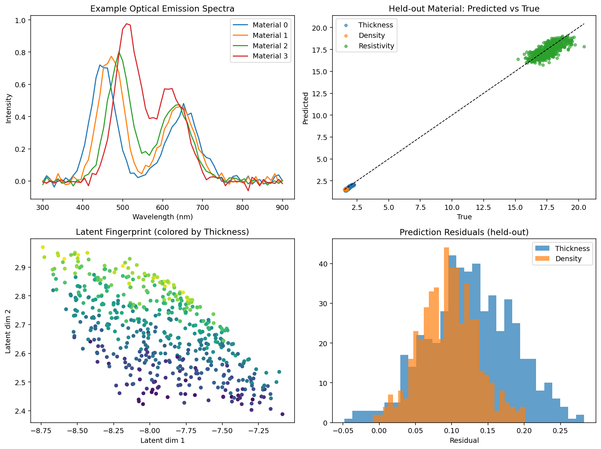

# Multi-Modal Material Fingerprint (Forward-Only Version)

This demo shows how to learn a compact **material fingerprint** from multi-modal plasma sensor data using a straightforward feed-forward neural network.

It is designed to illustrate core ideas relevant to a PlasmaSens platform:
- Fusing optical emission spectra, electrical signals, thermal features, and process parameters
- Creating a low-dimensional representation that captures material properties
- Testing generalization to a held-out material / domain


---

## Overview

We generate synthetic multi-modal data that mimics the types of signals produced by a cold atmospheric plasma sensor system:

| Modality          | Description                              | Dimension |
|-------------------|------------------------------------------|---------|
| Spectral          | Optical Emission Spectrum                | 64      |
| Electrical        | Peak current, phase, harmonic content    | 3       |
| Thermal           | Max temperature + spatial variation      | 2       |
| Process           | Power, gas flow, web speed               | 3       |

The network learns to map these inputs into a **32-dimensional latent fingerprint**, which is then used to predict three material properties:

- Thickness  
- Density  
- Resistivity  

The model is trained on three materials and evaluated on a completely held-out fourth material to test generalization.

---

## Model Architecture

```text
Spectral (64) ──► Encoder ──► 32
Electrical (3) ──► Encoder ──► 16
Thermal (2)   ──► Encoder ──►  8
Process (3)   ──► Encoder ──►  8
                              │
                              ▼
                     Concatenate (64)
                              │
                              ▼
                     Fusion Network
                              │
                              ▼
                  Latent Fingerprint (32)
                              │
                              ▼
                  Property Head → [Thickness, Density, Resistivity]

